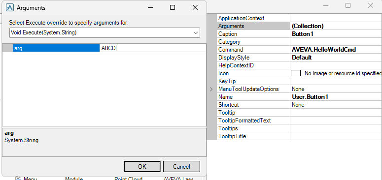

# 11. Commands

Commands are an essential part of the AVEVA customization ecosystem, allowing developers to execute actions directly through the UI or programmatically.

They act as entry points to trigger logic, automation, or scripts — both in PML and C# (via CommandManager).

In AVEVA applications, command management is handled through:

* **`CommandManager`** → in **C#**
* **`CMSYS`** → in **PML**

There are **two main ways** to create and use commands:

1. 🟩 **PML Commands** — defined directly using PML syntax.
2. 🟦 **C# Commands** — implemented in .NET for advanced logic. *(Covered in detail in the [E3D_CSharp_Addin](https://github.com/shivangKheradiya/E3D_CSharp_Addin) repository.)*

Below is a simple example demonstrating how to create a **custom command** that displays a *Hello World* message.
```pml
setup command !!HelloWorldCmd

exit

define method .HelloWorldCmd()
  -- initialise events and command key
  !this.key     = 'AVEVA.HelloWorldCmd'
  !this.execute = 'execute'
endmethod

define method .execute(!dummyArgs is ARRAY)

  q var !dummyArgs
  !!alert.message(|Hello World..!!!|)

endmethod

define method .execute(!dummyArgs is string)

  q var !dummyArgs

endmethod

```

## 🔍 Key Components

Every PML command definition consists of **three essential parts**:

| Component                      | Purpose                                                                       |
| ------------------------------ | ----------------------------------------------------------------------------- |
| `setup command`                | Declares the command to AVEVA’s internal system.                              |
| Constructor (`.HelloWorldCmd`) | Initializes command metadata, including the command key and execution method. |
| `execute` Method               | Defines the logic to be executed when the command is triggered.               |

## 📁 File Setup & Registration

After defining the command:

1. Save the file with a **`.pmlcmd`** extension in the **`pmllib`** folder.
2. Run the following commands in the **Command Window** to register it:

```pml
PML Rehash All
PML LOAD Command !!HelloWorldCmd
!!HelloWorldCmd.register()
```

✅ The command is now registered and can be executed via the UI or programmatically.

## ▶️ Executing the Command

There are three primary ways to trigger the command:

### 1️⃣ Execute via `CMSYS` (Programmatic Execution)

You can run the command directly through PML using the **Command System Manager** (`CMSYS`):

```pml
!!cmsys.EXECUTECOMMAND(|AVEVA.HelloWorldCmd|)
```

### 2️⃣ Execute via User Interface (Button Click)

Commands can also be integrated into the **UI configuration (UIC)** files.

For example, define a button in the UIC file and map it to your command key.


When clicked, this button executes the command, displaying:

```pml
<ARRAY>
   [0]  <STRING> 'ABCD'
```

Followed by the expected **“Hello World..!!!”** message box.

---

### 3️⃣ Execute via C# CommandManager (Advanced)

For developers integrating deeper into AVEVA’s C# API, commands can also be executed through the **`CommandManager`** class.
*(Detailed usage examples are available in the [E3D_CSharp_Addin Repository](https://github.com/shivangKheradiya/E3D_CSharp_Addin)).*

---

## 🧠 Notes & Best Practices

* Always ensure your **command keys are unique** (e.g., `AVEVA.MyCommandName`).
* Store `.pmlcmd` files in the appropriate **pmllib** directory for automatic discovery.
* Use **consistent naming conventions** between command keys and class/method names as well as file name.
* Rehash and reload commands whenever changes are made.
* Use `.execute` overloads to support multiple input types (`ARRAY`, `STRING`, etc.).

---
